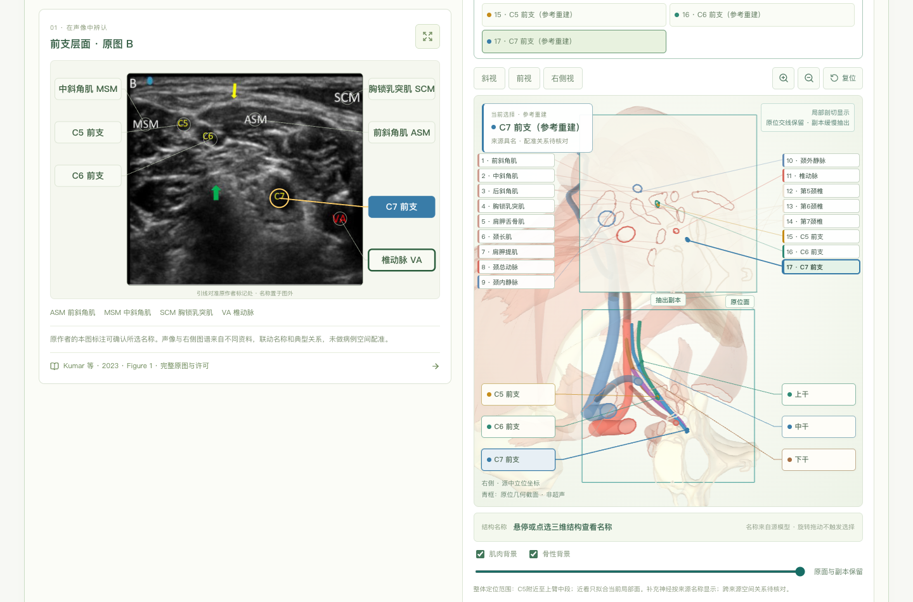
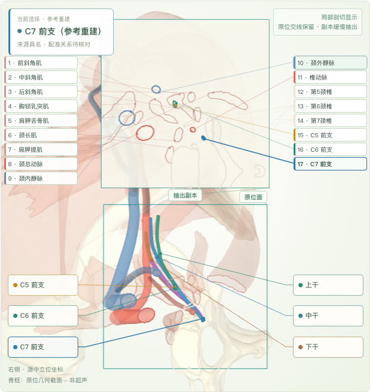

<div align="center">

# 麻醉解剖研习室

### Anesthesia Anatomy Atlas

**把超声图像、三维解剖和切面联系起来**  
**Connect ultrasound images, 3D anatomy, and cross-sections**

区域麻醉的交互式学习与教学工具  ·  An interactive regional anesthesia teaching tool

[中文](#中文) · [English](#english) · [素材与许可 / Sources & licenses](#素材与许可--sources--licenses)



*肌间沟模块：真实超声、三维参考模型与模型切面并排观察。*  
*Interscalene module: a real ultrasound image alongside the 3D reference and its model-derived section.*

</div>

---

## 中文

麻醉解剖研习室面向麻醉医生的个人学习和科室教学，帮助学习者把平面超声图像与神经、血管和肌肉的空间关系联系起来。目前包含**肌间沟臂丛神经阻滞**和**腋路臂丛神经阻滞**两个教学模块，界面以中文为主。

### 项目亮点

- **超声与三维并排学习**：对照真实超声图、三维结构和提取的模型切面，理解神经与周围肌肉、血管的关系。
- **点击名称联动高亮**：在肌间沟模块中选择 C5、C6、C7 等有对应标注的结构，可联动查看原超声与模型；原图未单独标明的结构会明确提示。
- **从三维走向二维**：放近并旋转至切面方向，缓慢抽出模型切面；结构轮廓配有中文名称和引线。
- **沿神经走行观察**：肌间沟模块提供 C5–T1 和上、中、下干的具名参考模型；腋路模块可选择主要终末神经观察。
- **离线学习与投屏**：提供单文件离线版本，也可在电脑上运行本地开发版。



*固定切面中显示实际与模型相交的结构；未相交的神经仍可在三维中查看。*

### 开始使用

**直接使用离线版：**下载仓库后，用现代桌面浏览器打开 [`交付文件/麻醉解剖双入路切面联动-v0.8.4.html`](交付文件/麻醉解剖双入路切面联动-v0.8.4.html)。浏览器的 `file://` 直接打开方式及实体 iPad 尚未实测；本机静态 HTTP 服务下的打包页面已测试。

**本地开发：**安装 Node.js 后，在项目目录运行：

```bash
npm install
npm run dev
```

终端会显示本地访问地址。构建离线文件使用 `npm run build:offline`，运行软件测试使用 `npm test`。

### 阅读边界

本工具用于**学习和教学**，不能作为患者穿刺、注药或临床决策的依据。肌间沟参考模型结合了不同来源的几何数据，虽按骨性标志进行刚体配准，但神经与周围组织的精确关系仍待专业核对。左侧超声和三维模型来自不同资料，**没有完成病例级空间配准**；结构名称联动不代表两者形状或位置完全一致。个体解剖和超声表现存在差异。

---

## English

Anesthesia Anatomy Atlas is an interactive learning and teaching tool for anesthesiologists. It helps connect a two-dimensional ultrasound image with the spatial relationships of nerves, vessels, and muscles. The current version includes **interscalene** and **axillary brachial plexus block** modules; the interface is primarily in Chinese.

### Highlights

- **Study ultrasound alongside 3D anatomy:** compare real ultrasound images with a reference model and model-derived cross-sections.
- **Linked structure selection:** in the interscalene module, select a named structure such as C5, C6, or C7 to highlight its corresponding views where the original ultrasound labels it.
- **From 3D to 2D:** zoom and rotate toward the section, then watch a copy of the model-derived section slowly separate, with Chinese labels and leader lines.
- **Follow neural pathways:** explore source-named C5–T1 and upper, middle, and lower trunk reference models, as well as major terminal nerves in the axillary module.
- **Offline study and teaching:** use the single-file offline edition or run the project locally for development.

### Getting started

**Offline:** Download the repository and open [`交付文件/麻醉解剖双入路切面联动-v0.8.4.html`](交付文件/麻醉解剖双入路切面联动-v0.8.4.html) in a modern desktop browser. The packaged page has been tested through a local HTTP server; direct `file://` use and a physical iPad have not yet been tested.

**Development:** Install Node.js, then run:

```bash
npm install
npm run dev
```

Use `npm run build:offline` to build the offline file and `npm test` to run the software tests.

### Interpretation

This is a **learning and teaching reference**, not a basis for patient-specific needle placement, injection, or clinical decisions. The interscalene reconstruction combines geometry from different sources. Bone-based rigid registration has been applied, but precise nerve–tissue relationships remain subject to expert review. The ultrasound image and 3D model come from different sources and **have not been spatially registered to the same patient**. Linked names do not imply exact correspondence of shape or position.

---

## 素材与许可 / Sources & licenses

**代码许可 / Code license:** 本项目原创软件代码采用 [MIT 许可证](LICENSE)。第三方模型、图像、解剖数据、截图、字体或其他素材及其改编作品仍适用各自原许可；离线 HTML 和 Blender 文件包含这些素材，不能整体按 MIT 使用。部分素材限制商业用途，请使用前逐项查阅以下说明。

Original software code in this repository is licensed under the [MIT License](LICENSE). Third-party models, images, anatomical data, screenshots, fonts and other assets and their adaptations retain their respective licenses. The offline HTML and Blender file contain such assets and are not wholly MIT-licensed. Some assets are restricted to noncommercial use; check each asset before reuse.


- 三维底座 / 3D base: [Z-Anatomy](https://github.com/Z-Anatomy/Models-of-human-anatomy)，相关几何及改编素材 / applicable geometry and adaptations: CC BY-SA 4.0.
- 具名神经补充 / Named nerve models: [Open3DModel via Ana3D](https://ana3d.app/en/atlas/o3d-upper-limb/)，CC BY-SA 4.0.
- 超声和其他图像 / Ultrasound and other images: 各素材分别适用其原始许可，部分限制商业使用；完整署名和使用范围见 [素材许可说明 / asset licenses](docs/ASSET-LICENSES.md) 及各素材目录。Each asset retains its own license; some are noncommercial. See the linked record and asset directories for attribution and scope.
- 软件依赖 / Software dependencies: [第三方软件声明 / third-party notices](public/THIRD_PARTY_NOTICES.txt).

更多验证与模型局限 / Verification and model limitations: [v0.8.4 verification](docs/verification-v084.md).
